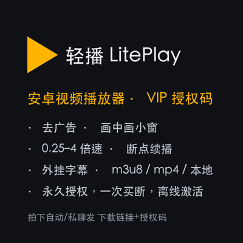
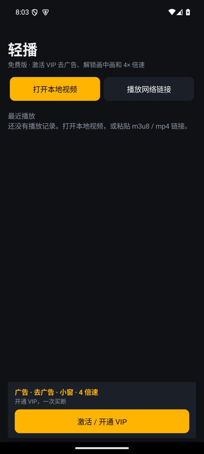
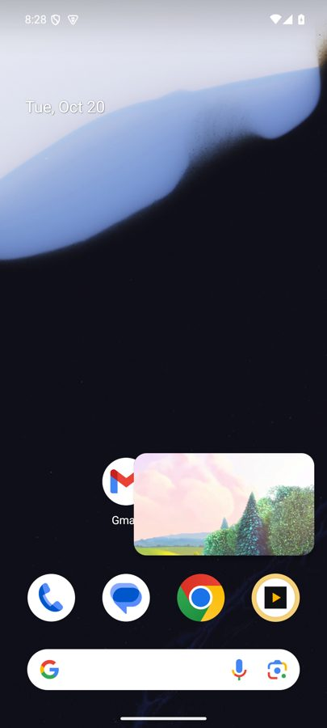

# 轻播 LitePlay

A clean Android video player · 一个干净的安卓视频播放器：本地视频、m3u8 / mp4 链接、外挂字幕、续播，开箱即用。不带内容、不收集数据。

**Download / 下载**：[LitePlay-1.2.0.apk](https://github.com/CodeHYY/liteplay/releases/download/v1.2.0/LitePlay-1.2.0.apk)（1.9 MB，Android 8.0+）· [Landing page](https://codehyy.github.io/liteplay/)

   

## English summary
- Plays local files, http(s) links, HLS (m3u8) and DASH; external .srt/.vtt subtitles; resume playback.
- Privacy: only the `INTERNET` permission, no analytics SDK, no account, no uploads. Ships with no media content.
- Free: speed 0.25×–2×, 5 resume entries, a dismissible ad at most every 3rd playback (none for your first 2 plays, 3-min minimum gap, daily cap), a closable banner, and an optional “watch one ad → 12 h ad-free”. Every ad is labelled “广告” and closes with one tap. VIP (one-time offline license key): no ads, picture-in-picture, up to 4× speed, 200 resume entries.
- Verify: `shasum -a 256 LitePlay-1.2.0.apk` → `cb257a719d8233df873d79dc9f307e74e7b16b97ec0bc640174ad2c04b38f597`.

## 功能

| | 免费版 | VIP |
|---|---|---|
| 本地视频 / http(s) 链接 / HLS(m3u8) / DASH | ✅ | ✅ |
| 外挂字幕 (.srt / .vtt) | ✅ | ✅ |
| 断点续播 | ✅ 保留最近 5 条 | ✅ 保留最近 200 条 |
| 倍速 | 0.25×–2× | 0.25×–4× |
| 画中画小窗（按 Home 自动小窗） | ❌ | ✅ |
| 广告 | 约每 3 次播放最多 1 条插屏（新用户前 2 次不出、间隔≥3 分钟、每天≤6 条），均标「广告」、打开即可一键关闭；首页横幅可关闭；可主动看一条广告换 12 小时免广告 | 无广告 |

## 下载

在 [Releases](../../releases/latest) 下载 `LitePlay-*.apk`，安装时按系统提示允许“安装未知来源应用”。需要 Android 8.0+。

校验：`shasum -a 256 LitePlay-1.2.0.apk` 应与 Release 说明里的 SHA-256 一致。

## 隐私

- 不申请通讯录、定位、相机、麦克风、存储权限（本地视频通过系统文件选择器授权）。
- 只有 `INTERNET`：播放你填写的网络链接时才联网。
- 无统计 SDK、无账号、无上传。播放历史只保存在本机。

## 开通 VIP

App 内「激活 / 开通 VIP」输入授权码即可，授权码离线校验（ECDSA 签名），不需要联网、不需要账号。
购买方式见 App 内「购买」按钮。

## 声明

轻播只是播放器，不提供、不内置任何影视内容。请只播放你有权观看的内容。本页文案由 AI 辅助撰写。截图中的演示视频：Big Buck Bunny © Blender Foundation，CC-BY 3.0。

## 1.2.0 说明 / Notes
- 广告合规升级：「广告」标签 + 一键关闭（无倒计时门槛）、频率控制、主动看广告换免广告时段、外链广告点击前显示去向域名；点击才跳转，不自动下载。`ads.json` 新增 `settings` 段（远程开关与频率，数值有硬上下限）。/ Ads are labelled, close with one tap (no countdown gate), are rate-limited, and links show their destination before you tap; nothing downloads automatically.

## 1.1.0 说明 / Notes
- 广告位内容来自 `https://codehyy.github.io/liteplay/ads.json`（只接受 https 链接；读取失败时显示自家 VIP 广告，不影响播放）。这是 App 唯一的后台请求，不上传任何用户数据。/ The app's only background request is a plain GET of that ads.json; nothing is uploaded.
- VIP 为年卡（1 年），只解锁功能，不含任何影视内容，也不保证第三方链接可用。/ VIP is a 1-year license that unlocks features only; no content is provided or guaranteed.
